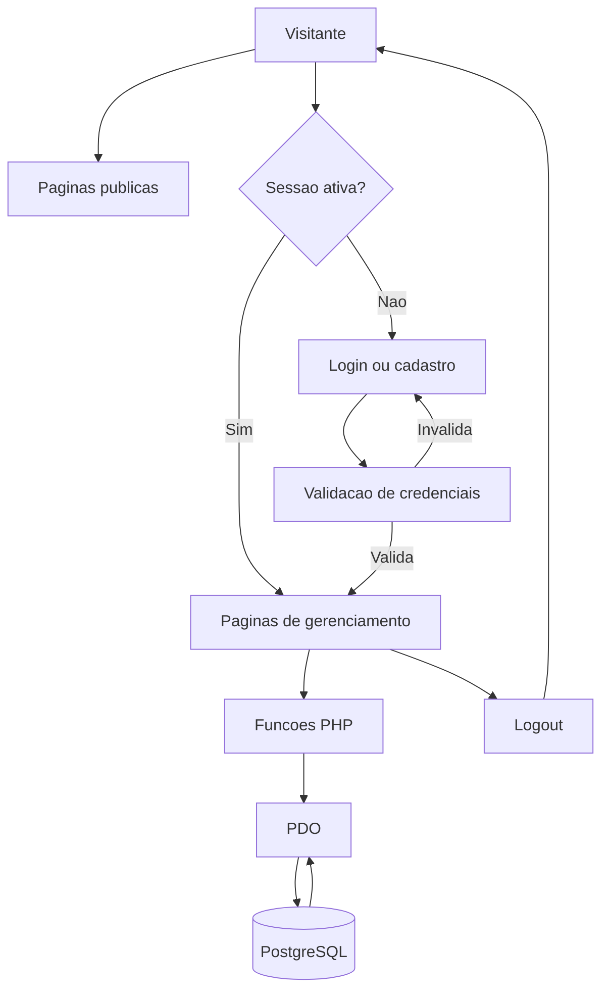
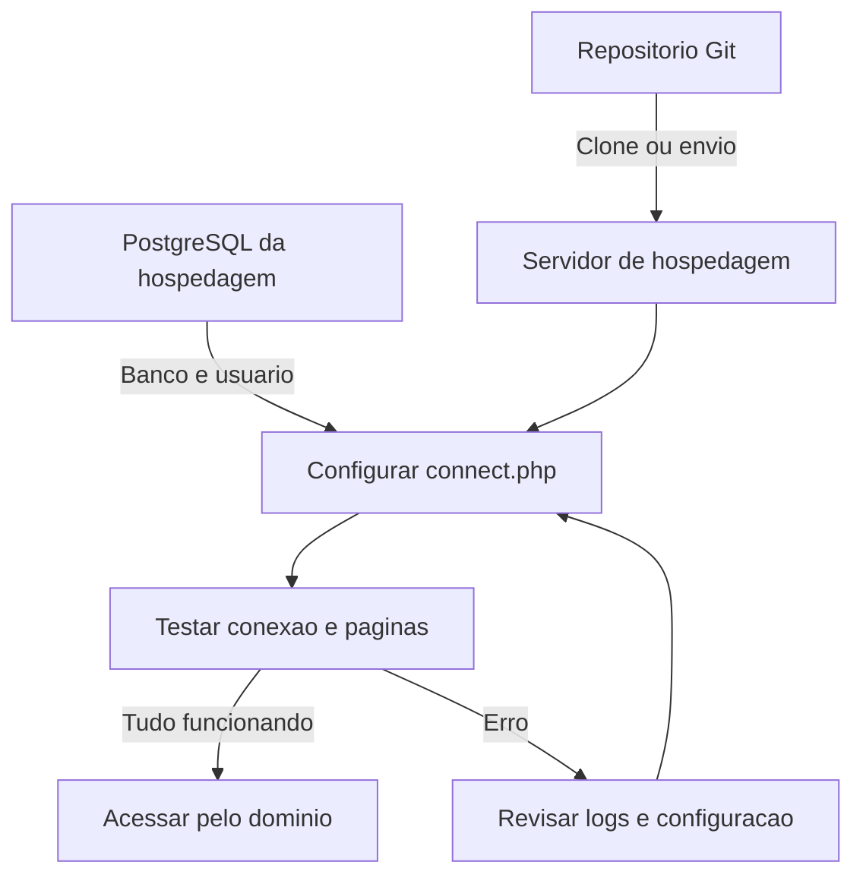

# Sistema de Cadastro de Músicas

Aplicação web desenvolvida para cadastrar e gerenciar músicas. O sistema utiliza PHP para processar as informações, PostgreSQL para armazenar os dados e PDO para realizar a comunicação com o banco de dados.

## Sumário

- [1. Sobre o projeto](#1-sobre-o-projeto)
- [2. Funcionalidades](#2-funcionalidades)
- [3. Interface](#3-interface)
- [4. Tecnologias utilizadas](#4-tecnologias-utilizadas)
- [5. Requisitos](#5-requisitos)
- [6. Estrutura do projeto](#6-estrutura-do-projeto)
- [7. Como clonar o repositório](#7-como-clonar-o-repositório)
- [8. Configuração do banco de dados](#8-configuração-do-banco-de-dados)
- [9. Configuração da conexão](#9-configuração-da-conexão)
- [10. Como executar o sistema localmente](#10-como-executar-o-sistema-localmente)
- [11. Como testar as funcionalidades](#11-como-testar-as-funcionalidades)
- [12. Como realizar o deploy](#12-como-realizar-o-deploy)
- [13. Segurança e limitações](#13-segurança-e-limitações)

## 1. Sobre o projeto

O Sistema de Cadastro de Músicas foi desenvolvido como um projeto de estudo para praticar o desenvolvimento de aplicações web.

A aplicação permite organizar músicas por título, artista, álbum e gênero musical. Também possui cadastro de usuários, login e páginas públicas para apresentar o projeto.

O desenvolvimento tem como objetivo praticar:

- Desenvolvimento web com PHP, HTML e CSS;
- Operações CRUD: cadastrar, consultar, atualizar e excluir;
- Consultas SQL utilizando PDO;
- Autenticação básica com sessões;
- Organização dos arquivos em diretórios.


## 2. Funcionalidades

- Cadastro de usuários;
- Login e logout;
- Cadastro de músicas;
- Consulta e listagem de músicas;
- Atualização de músicas pelo ID;
- Exclusão de músicas pelo ID;
- Páginas públicas de início, sobre, produtos e contato;
- Proteção por sessão nas páginas de gerenciamento.

## 3. Interface

O sistema possui páginas públicas e páginas destinadas ao gerenciamento das músicas.

| Arquivo | Acesso e função |
|---|---|
| `index.php` | Página inicial pública. |
| `sobre.php` | Página pública sobre o projeto. |
| `produtos.php` | Página pública de produtos. |
| `contato.php` | Formulário visual de contato; não envia mensagens. |
| `login/login.php` | Tela de login. |
| `login/cadastrar.php` | Cadastro de usuário. |
| `login/logout.php` | Encerra a sessão e volta para a página inicial. |
| `app/create.php` | Cadastra uma música; exige login. |
| `app/delete.php` | Exclui uma música pelo ID; exige login. |
| `app/select.php` | Lista as músicas cadastradas; exige login. |
| `app/select_w.php` | Consulta uma música pelo ID; exige login. |
| `app/update.php` | Atualiza os dados de uma música pelo ID; exige login. |

A interface utiliza HTML e CSS, com arquivos compartilhados para o cabeçalho e o rodapé.

## 4. Tecnologias utilizadas

- **HTML:** estrutura das páginas;
- **CSS:** estilização da interface;
- **PHP:** processamento das informações;
- **PostgreSQL:** armazenamento dos dados;
- **PDO:** comunicação com o banco de dados;
- **Git:** controle de versão do projeto.

## 5. Requisitos

Para executar o sistema, é necessário ter:

- PHP instalado;
- PostgreSQL instalado ou acesso a um servidor PostgreSQL;
- Extensões `PDO` e `pdo_pgsql` habilitadas no PHP;
- Git instalado;
- Navegador web.

Para verificar a instalação do PHP, execute:

```bash
php -v
```

Para conferir as extensões disponíveis:

```bash
php -m
```

Verifique se aparecem `PDO` e `pdo_pgsql` na lista.

O projeto não possui gerenciador de dependências PHP ou etapa de compilação configurada.

## 6. Estrutura do projeto

```text
musicbia/
├── app/
│   ├── create.php
│   ├── delete.php
│   ├── dir.php
│   ├── select.php
│   ├── select_w.php
│   └── update.php
├── database/
│   ├── connect.php
│   └── musicas.sql
├── includes/
│   ├── footer.php
│   ├── functions.php
│   └── header.php
├── img/
│   └── logo.png
├── login/
│   ├── cadastrar.php
│   ├── login.php
│   ├── logout.php
│   └── verifica_user.php
├── style/
│   └── style.css
├── contato.php
├── index.php
├── produtos.php
├── sobre.php
└── README.md
```

### Principais diretórios

- `app/`: páginas responsáveis pelas operações com músicas;
- `database/`: conexão com o banco e dump SQL existente;
- `includes/`: funções e partes compartilhadas das páginas;
- `img/`: imagens utilizadas no site;
- `login/`: páginas de autenticação e cadastro de usuários;
- `style/`: arquivo CSS.

## 7. Como clonar o repositório

### Passo 1 — Abrir o terminal

Abra o terminal do sistema ou do ambiente em que o projeto será executado.

### Passo 2 — Escolher a pasta

Entre na pasta em que deseja salvar o projeto. No PowerShell do Windows, por exemplo:

```bash
cd $HOME\Documents
```

No macOS ou Linux, o caminho pode variar; por exemplo, `cd ~/Documents`.

### Passo 3 — Clonar o repositório

Execute o comando abaixo, substituindo `SEU_USUARIO` e `SEU_REPOSITORIO` pelos dados reais do repositório. O segundo argumento cria a pasta `musicbia`, nome esperado pelos links do menu do projeto:

```bash
git clone https://github.com/SEU_USUARIO/SEU_REPOSITORIO.git musicbia
```

### Passo 4 — Entrar na pasta do projeto

Entre na pasta `musicbia` criada pelo clone:

```bash
cd musicbia
```

Se o repositório criar uma pasta com outro nome, entre na pasta correspondente.

### Passo 5 — Conferir os arquivos

Execute:

```bash
ls
```

No Windows, também é possível utilizar:

```bash
dir
```

A pasta deve conter o arquivo `index.php` e os diretórios do projeto.

## 8. Configuração do banco de dados

O sistema utiliza um banco de dados PostgreSQL chamado `musicas`.

A aplicação espera encontrar duas tabelas: `musicas` e `usuarios`.

### Passo 1 — Criar o banco

Acesse o PostgreSQL pelo pgAdmin ou pelo terminal e execute:

```sql
CREATE DATABASE musicas;
```

Depois, conecte-se ao banco `musicas`.

### Passo 2 — Criar a tabela de músicas

Execute o comando dentro do banco criado:

```sql
CREATE TABLE musicas (
    id SERIAL PRIMARY KEY,
    titulo VARCHAR(100) NOT NULL,
    artista VARCHAR(100) NOT NULL,
    album VARCHAR(100) NOT NULL,
    genero VARCHAR(50) NOT NULL
);
```

### Passo 3 — Criar a tabela de usuários

Ainda dentro do banco `musicas`, execute:

```sql
CREATE TABLE usuarios (
    id SERIAL PRIMARY KEY,
    email VARCHAR(100) NOT NULL UNIQUE,
    senha VARCHAR(100) NOT NULL
);
```

### Passo 4 — Conferir as tabelas

A estrutura esperada é:

| Tabela | Colunas |
|---|---|
| `musicas` | `id`, `titulo`, `artista`, `album`, `genero` |
| `usuarios` | `id`, `email`, `senha` |

Você pode executar os comandos pelo Query Tool do pgAdmin ou pelo `psql`.

> **Atenção:** o arquivo `database/musicas.sql` é um dump de uma base existente e contém dados de teste, incluindo senhas em texto puro. Para iniciar uma instalação limpa, utilize os comandos de criação das tabelas apresentados nesta seção. Não importe o dump em produção.

## 9. Configuração da conexão

O arquivo `database/connect.php` é responsável por conectar o PHP ao PostgreSQL utilizando PDO. No código atual, host, banco, usuário e senha estão definidos diretamente nesse arquivo. Abra-o e substitua os valores existentes pelos dados do seu ambiente; não reutilize credenciais de exemplo nem publique credenciais reais.

### Passo 1 — Abrir o arquivo

Abra:

```text
database/connect.php
```

### Passo 2 — Configurar os dados de acesso

Ajuste os valores para corresponderem ao ambiente em que o sistema será executado.

Exemplo:

```php
$host = "localhost";
$dbname = "musicas";
$user = "seu_usuario";
$pass = "sua_senha";
```

Os valores são apenas um exemplo. Utilize o host, o banco, o usuário e a senha corretos. A conexão atual não define uma porta separada; se o seu PostgreSQL usar uma porta não padrão, ajuste o DSN PDO nesse mesmo arquivo.

No ambiente de produção, mantenha as credenciais protegidas e fora do repositório Git.

## 10. Como executar o sistema localmente

Depois de configurar o banco e a conexão, siga os passos abaixo.

### Passo 1 — Acessar a pasta que contém o projeto

O cabeçalho do código usa links absolutos começando por `/musicbia`. Por isso, mantenha a pasta do projeto com o nome `musicbia` e inicie o servidor PHP **na pasta que contém essa pasta**, e não dentro dela. Por exemplo, se o projeto estiver em `Documents\musicbia`, no PowerShell execute:

```bash
cd $HOME\Documents
```

Se o projeto estiver em outro local, entre na pasta que contém `musicbia`.

### Passo 2 — Iniciar o servidor PHP

Execute:

```bash
php -S 127.0.0.1:8000
```

Mantenha o terminal aberto enquanto estiver utilizando o sistema.

### Passo 3 — Abrir o navegador

Acesse a rota do projeto:

http://127.0.0.1:8000/musicbia/index.php

A página inicial deverá aparecer. No código atual, os links do menu usam o prefixo `/musicbia`; se a pasta ou a URL forem diferentes, será necessário ajustar os links em `includes/header.php`.

### Passo 4 — Cadastrar um usuário

Acesse:

http://127.0.0.1:8000/musicbia/login/cadastrar.php

Cadastre um e-mail e uma senha para realizar os testes.

### Passo 5 — Fazer login

Acesse:

http://127.0.0.1:8000/musicbia/login/login.php

Entre com os dados cadastrados.

> O servidor embutido do PHP é indicado para desenvolvimento local. Para publicar o sistema na internet, utilize uma hospedagem configurada para PHP e PostgreSQL.

## 11. Como testar as funcionalidades

Depois de entrar no sistema, realize os seguintes testes:

1. Cadastre um usuário.
2. Faça login com os dados cadastrados.
3. Cadastre uma música preenchendo todos os campos.
4. Acesse a página de consulta e verifique se a música foi salva.
5. Consulte uma música pelo ID, conforme a funcionalidade disponível.
6. Atualize os dados de uma música.
7. Exclua uma música de teste.
8. Faça logout e verifique o encerramento da sessão.
9. Tente acessar uma página de gerenciamento sem estar autenticado.

Se alguma operação apresentar erro, confira a conexão com o banco, as permissões do usuário PostgreSQL e os logs do PHP.

## 12. Como realizar o deploy

O deploy consiste em publicar a aplicação em um servidor para que ela possa ser acessada pelo navegador.

Os comandos e as opções de configuração podem variar conforme a hospedagem utilizada.

### Como a aplicação funciona

O fluxo básico da aplicação pode ser representado pelo diagrama abaixo:



### Etapas de publicação

#### Passo 1 — Preparar a hospedagem

Confirme se o servidor oferece:

- PHP com suporte a `PDO` e `pdo_pgsql`;
- PostgreSQL;
- Acesso para enviar os arquivos por Git/SSH, SFTP ou painel de arquivos;
- Configuração de domínio e HTTPS.

#### Passo 2 — Enviar o projeto

O menu do projeto contém links absolutos com o prefixo `/musicbia`. Para que esses links funcionem sem alteração, publique o projeto em uma URL que use esse caminho (por exemplo, `https://seu-dominio.com/musicbia/`) e mantenha a pasta com o nome `musicbia`. Se quiser publicar na raiz do domínio ou usar outro nome de pasta, ajuste os links em `includes/header.php`.

Se a hospedagem permitir acesso por terminal e Git, clone o repositório com o nome esperado:

```bash
git clone https://github.com/SEU_USUARIO/SEU_REPOSITORIO.git musicbia
```

Entre na pasta criada:

```bash
cd musicbia
```

Se o servidor não oferecer Git, envie os arquivos por SFTP ou pelo painel de arquivos da hospedagem.

Publique a pasta `musicbia` dentro da raiz pública do site, ou configure o provedor para que ela seja servida pela rota `/musicbia/`.

#### Passo 3 — Criar o banco de produção

No PostgreSQL da hospedagem:

1. Crie o banco `musicas`, ou ajuste o nome conforme a configuração escolhida.
2. Crie um usuário exclusivo para a aplicação.
3. Conceda somente as permissões necessárias.
4. Crie as tabelas conforme a seção [Configuração do banco de dados](#8-configuração-do-banco-de-dados).

Não utilize dados pessoais ou contas reais nos testes iniciais.

#### Passo 4 — Configurar a conexão no servidor

Abra `database/connect.php` no ambiente de produção e configure os dados fornecidos pela hospedagem.

Não envie senhas reais para o Git e não publique arquivos contendo credenciais.

#### Passo 5 — Proteger os arquivos internos

Configure o servidor para impedir o acesso direto e o download de arquivos internos, como os arquivos de conexão, SQL e funções.

Também desative a listagem de diretórios. Se a hospedagem não permitir essas proteções, adapte a estrutura do projeto antes de publicá-lo.

#### Passo 6 — Configurar o domínio e o HTTPS

No painel da hospedagem:

1. Configure o domínio ou subdomínio e escolha a URL/pasta onde o projeto será publicado.
2. Mantenha a rota `/musicbia/` ou ajuste os links absolutos em `includes/header.php` para a rota escolhida.
3. Habilite o certificado SSL/TLS.
4. Confirme que o site pode ser acessado por HTTPS.

#### Passo 7 — Testar a aplicação publicada

Acesse o domínio e teste:

- Página inicial e páginas públicas;
- Cadastro e login de usuários;
- Cadastro e consulta de músicas;
- Atualização e exclusão;
- Logout e proteção das páginas de gerenciamento.

Se houver falhas, consulte os logs do PHP e verifique a conexão com o PostgreSQL, as permissões e as extensões instaladas.

#### Passo 8 — Atualizar o projeto

Antes de atualizar a aplicação, faça backup dos arquivos e do banco de dados.

Se o projeto estiver sendo atualizado por Git, entre na pasta do repositório e confira se existem alterações locais:

```bash
git status
```

Depois de preservar as alterações necessárias, atualize o código:

```bash
git pull
```

Não execute atualizações sem verificar se elas podem afetar a configuração ou os dados existentes.

### Fluxo do deploy

O processo de publicação pode ser representado pelo seguinte diagrama:



### Checklist antes de colocar no ar

- [ ] O banco de produção foi criado e contém apenas os dados apropriados.
- [ ] As credenciais de produção não estão no Git nem em um repositório público.
- [ ] Arquivos internos e diretórios sensíveis não podem ser baixados pelo navegador.
- [ ] O site está acessível por HTTPS.
- [ ] Implementar armazenamento e validação seguros de senhas (atualmente são armazenadas em texto puro).
- [ ] Foram feitos testes de login, cadastro, consulta, atualização e exclusão.
- [ ] Existe um plano de backup do banco de produção.

## 13. Segurança e limitações

Este projeto foi desenvolvido para fins de estudo e precisa de ajustes antes de ser utilizado em produção.

- **Senhas:** o código atual armazena e compara senhas em texto puro. Antes de utilizar contas reais, implemente `password_hash()` para armazenar as senhas e `password_verify()` para validá-las.
- **Credenciais:** não publique senhas do PostgreSQL ou outras informações de acesso no repositório.
- **Arquivos internos:** restrinja o acesso público aos arquivos de conexão, funções e dumps SQL.
- **Dados de teste:** o arquivo `database/musicas.sql` contém dados de teste e senhas em texto puro; não o importe em produção nem publique dados reais nele.
- **Formulário de contato:** a página apresenta um formulário, mas o projeto não possui um serviço configurado para enviar as mensagens.
- **Caminhos do site:** o menu em `includes/header.php` usa o caminho fixo `/musicbia`. As páginas também usam caminhos relativos para CSS e imagens; se publicar em outra rota ou perceber que o estilo/logo não carrega, ajuste os caminhos no código para a URL usada.
- **Página inicial e arquivos estáticos:** `index.php` referencia o CSS e o logo usando `../style/` e `../img/`. Dependendo da rota configurada, esses caminhos podem apontar para fora da pasta do projeto; confirme no navegador se o estilo e a imagem carregam.
- **Ambiente de execução:** o servidor embutido do PHP deve ser utilizado somente para desenvolvimento local.
- **Backup:** mantenha cópias de segurança do banco de dados antes de realizar alterações ou atualizações.

